# Monitorización de Sistemas en Linux
## Objetivo
El objetivo de esta práctica es conocer, instalar y utilizar las principales herramientas de monitorización disponibles en sistemas GNU/Linux (Ubuntu), aprendiendo a interpretar la información crítica que proporcionan sobre el rendimiento, uso de recursos y estado de red de un servidor. Asimismo, se emplea Markdown y GitHub para documentar de forma estructurada los resultados obtenidos.

## Índice de Contenidos
  1. Procesos y CPU   
        ◦ ps  
        ◦ top  
        ◦ htop  
        ◦ atop  
  2. Memoria RAM  
        ◦ free  
  3. Almacenamiento  
        ◦ df  
        ◦ du  
        ◦ iostat  
  4. Tráfico de Red  
        ◦ tcpdump  
        ◦ tcptrack  
        ◦ iptraf  
        ◦ bmon  
  5. Puertos y Conexiones  
        ◦ ss  
        ◦ nmap  
  6. Análisis de Resultados  

## 1. Procesos y CPU
## 1.1. ps
  • Finalidad: Muestra una instantánea estática de los procesos activos en el sistema en el momento exacto en que se ejecuta el comando. Permite conocer el PID (identificador de proceso), el usuario propietario, el consumo de CPU/RAM y el comando ejecutado.    
  • Instalación: Viene preinstalado por defecto en Ubuntu (paquete procps).  
  • Sintaxis y opciones:  
      ps [opciones]  
        ◦ aux: Muestra todos los procesos de todos los usuarios (a, x) en un formato orientado al usuario con detalles de CPU y memoria (u).  
        ◦ -ef: Muestra todos los procesos en formato completo estándar, incluyendo el PPID (PID del proceso padre).  
  • Captura de pantalla:   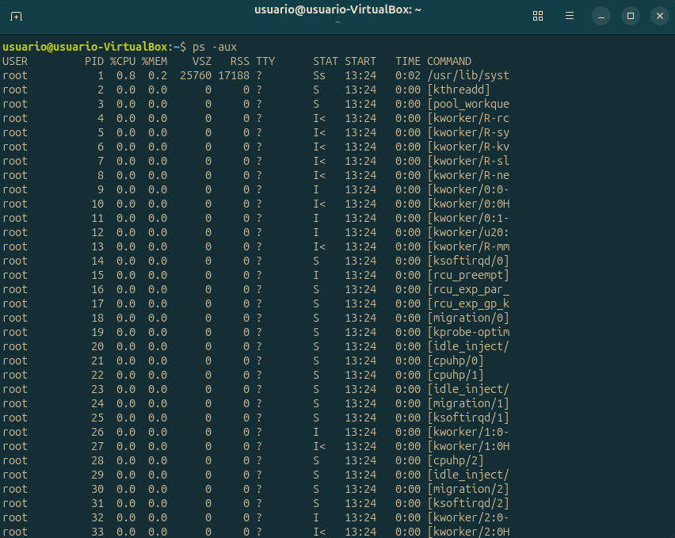 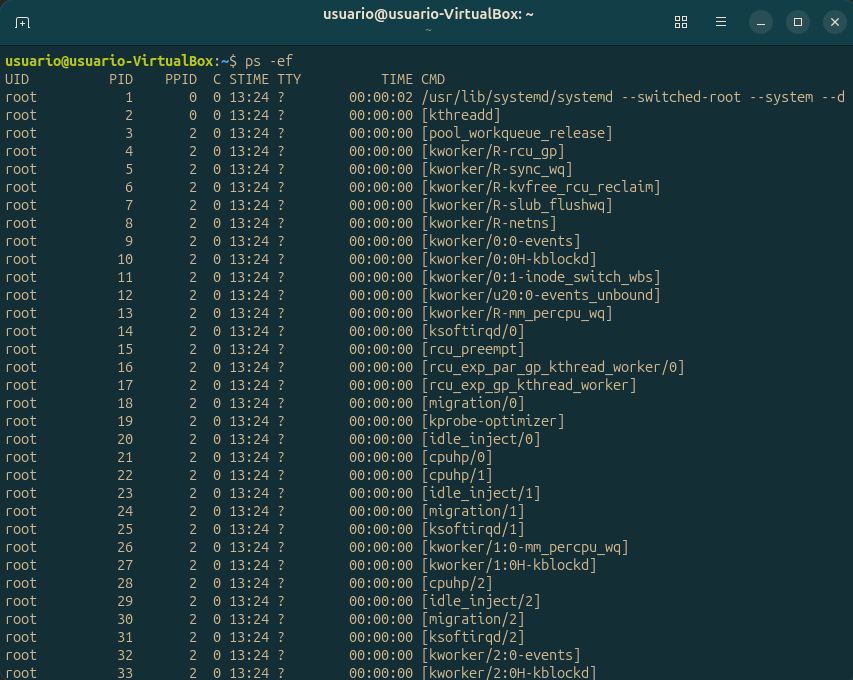  
  • Interpretación: En pantalla se observan columnas como USER, PID, %CPU, %MEM, STAT (estado del proceso, por ejemplo, S dormido o R en ejecución) y COMMAND. Un administrador utiliza esta herramienta para identificar rápidamente qué proceso está consumiendo demasiados recursos o para obtener su PID y detenerlo con kill si se ha quedado bloqueado.  
## 1.2. top
  • Finalidad: Proporciona una vista dinámica y en tiempo real de los procesos en ejecución, además de un resumen global del estado del sistema (tiempo encendido, carga media, uso de CPU y memoria).  
  • Instalación: Preinstalado por defecto en Ubuntu (paquete procps).  
  • Sintaxis y opciones:  
      top [opciones]  
        ◦ -d <segundos>: Establece el intervalo de actualización de la pantalla (ej. top -d 2 actualiza cada 2 segundos).  
        ◦ -u <usuario>: Filtra y muestra únicamente los procesos pertenecientes a un usuario específico.  
  • Captura de pantalla:    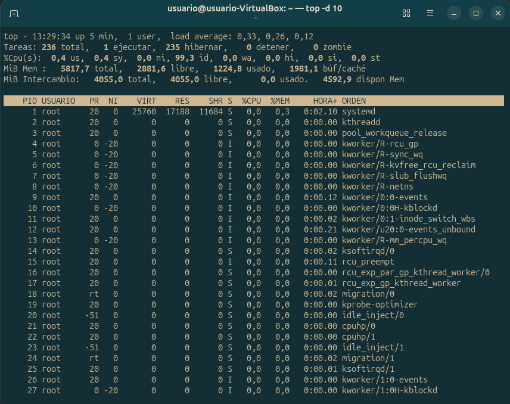 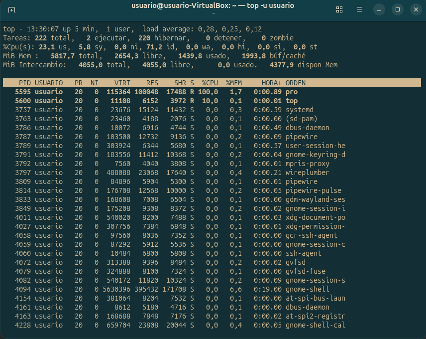  
  • Interpretación: La cabecera muestra el load average (carga media del sistema en 1, 5 y 15 minutos) y el desglose del uso de CPU (us usuario, sy sistema, id inactivo). Debajo aparece la lista ordenada por consumo de CPU. Permite diagnosticar en vivo si un servidor está saturado por procesos de usuario o por operaciones del kernel.  
## 1.3. htop
  • Finalidad: Es un visor de procesos interactivo y mejorado respecto a top. Permite desplazarse vertical y horizontalmente, gestionar procesos mediante teclas de función (matar, cambiar prioridad/nice) y visualizar barras gráficas de uso por cada núcleo de CPU.  
  • Instalación:  
    sudo apt update && sudo apt install htop -y  
  • Sintaxis y opciones:  
     htop [opciones]  
        ◦ -t: Muestra los procesos en formato de árbol (tree), facilitando ver la jerarquía entre procesos padres e hijos.  
        ◦ -p <PID,PID>: Monitoriza únicamente los identificadores de proceso indicados.  
  • Captura de pantalla:    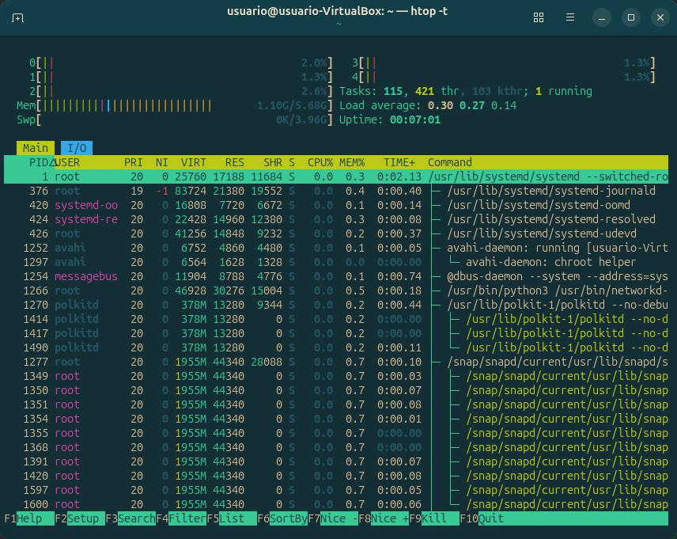 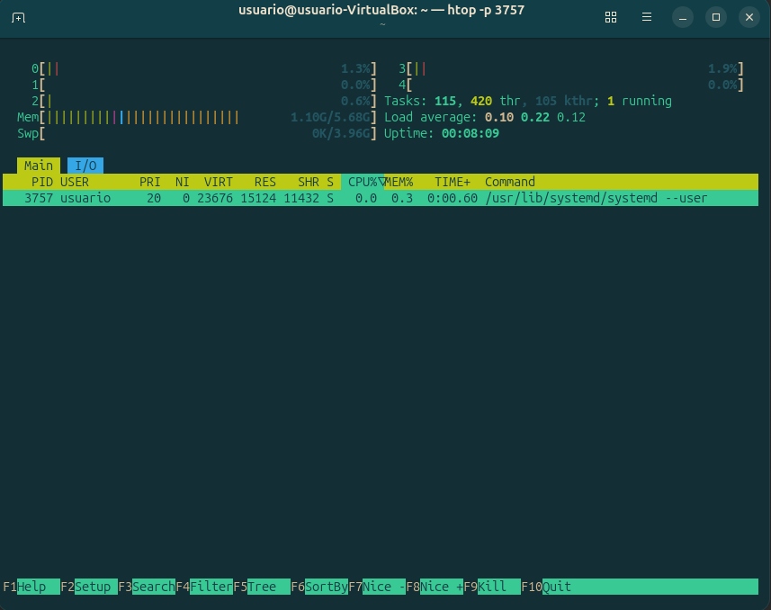  
  • Interpretación: Muestra barras de colores en la parte superior que representan el uso individual de cada hilo de CPU, la memoria RAM y la Swap. Es ideal para administradores que necesitan una interfaz visual ágil para detectar cuellos de botella en núcleos concretos o finalizar árboles de procesos complejos sin necesidad de escribir comandos adicionales.  
## 1.4. atop
  • Finalidad: Monitor avanzado de rendimiento del sistema a nivel de proceso y hardware. A diferencia de top, registra la actividad de todos los recursos críticos (CPU, memoria, disco y red) y permite guardar históricos para analizar fallos pasados.  
  • Instalación:  
     sudo apt update && sudo apt install atop -y  
  • Sintaxis y opciones:  
      atop [opciones] [intervalo]  
        ◦ -d: Muestra la actividad de lectura/escritura en disco por cada proceso.  
        ◦ -n: Muestra el consumo de red asociado a cada proceso (requiere módulo del kernel netatop).  
  • Captura de pantalla:    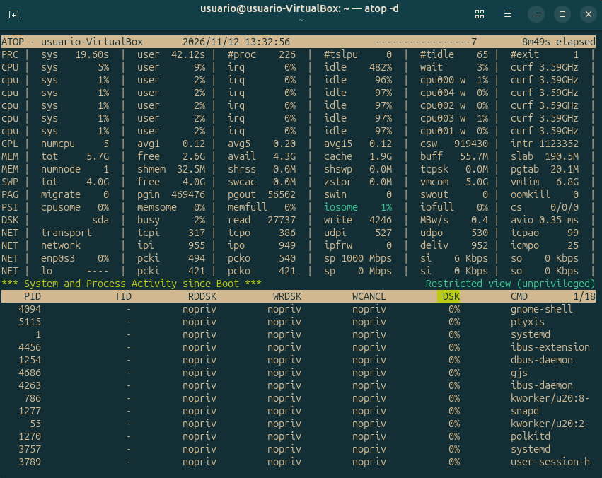 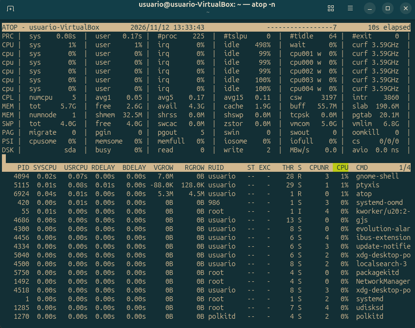  
  • Interpretación: Divide la pantalla en dos mitades: la superior resume el hardware (CPU, CPL, MEM, SWP, DSK, NET) y resalta en rojo los recursos sobrecargados; la inferior detalla los procesos. Es fundamental para auditorías de rendimiento y para averiguar qué proceso provocó una caída de rendimiento momentos antes.  

## 2. Memoria RAM
## 2.1. free
   • Finalidad: Muestra la cantidad total de memoria física (RAM) y memoria de intercambio (Swap) disponible, utilizada y libre en el sistema, así como la memoria empleada por el kernel para búferes y caché.  
   • Instalación: Preinstalado por defecto en Ubuntu (paquete procps).  
   • Sintaxis y opciones:  
      free [opciones]  
        ◦ -h: Muestra los valores en formato legible para humanos (human-readable: MiB, GiB).  
        ◦ -s <segundos>: Ejecuta el comando de forma continua refrescando los datos cada N segundos.  
   • Captura de pantalla:    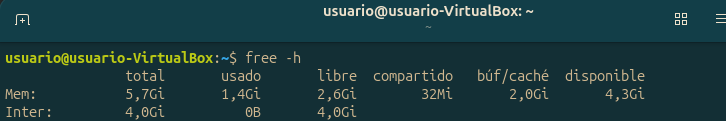 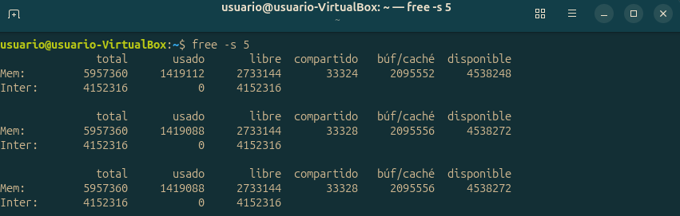  
   • Interpretación: Presenta columnas como total, used, free, shared, buff/cache y available. Un administrador se fija principalmente en la columna available, ya que indica cuánta memoria real está disponible para iniciar nuevas aplicaciones sin necesidad de recurrir a la memoria Swap (cuyo uso excesivo degrada gravemente el rendimiento).  

## 3. Almacenamiento
## 3.1. df
   • Finalidad: (Disk Free) Informa sobre el espacio utilizado y disponible en los sistemas de archivos (particiones y discos) montados actualmente en el sistema.  
   • Instalación: Preinstalado por defecto en Ubuntu (paquete coreutils).  
   • Sintaxis y opciones:  
      df [opciones]  
        ◦ -h: Muestra el tamaño en unidades legibles (KB, MB, GB).  
        ◦ -T: Incluye una columna adicional indicando el tipo de sistema de archivos (ej. ext4, tmpfs, xfs).  
   • Captura de pantalla:    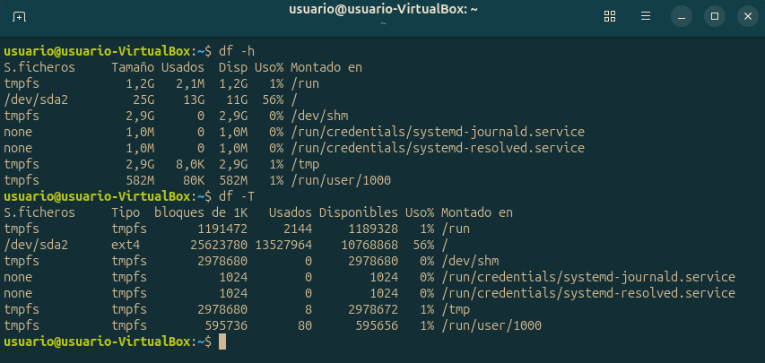   
   • Interpretación: Muestra el dispositivo (Filesystem), tamaño total, espacio usado, disponible, porcentaje de uso (Use%) y punto de montaje (Mounted on). Permite prevenir caídas de servicios causadas por particiones llenas al 100% (como /var o /).  
## 3.2. du
   • Finalidad: (Disk Usage) Estima y resume el espacio en disco ocupado por archivos y directorios específicos.  
   • Instalación: Preinstalado por defecto en Ubuntu (paquete coreutils).  
   • Sintaxis y opciones:  
      du [opciones] [ruta]  
        ◦ -s: Muestra únicamente el tamaño total de cada argumento especificado (summary), sin listar todos los subdirectorios.  
        ◦ -h: Muestra los tamaños en formato legible (KB, MB, GB). (Combinados como du -sh *).  
   • Captura de pantalla:    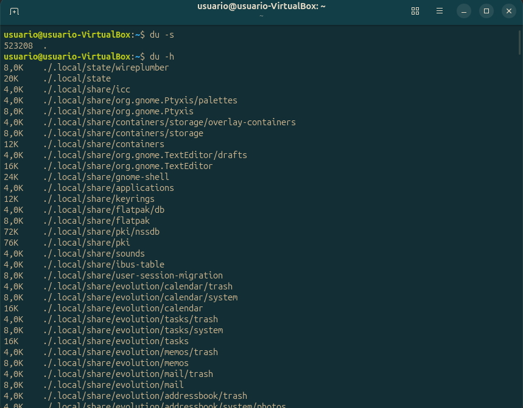   
   • Interpretación: Lista el peso de cada carpeta o archivo. Cuando df alerta de que un disco está lleno, el administrador utiliza du para navegar por las carpetas y localizar exactamente qué directorio, archivo de log o copia de seguridad está consumiendo todo el espacio.  
## 3.3. iostat
   • Finalidad: Monitoriza la carga de los dispositivos de almacenamiento (discos duros/SSD) observando los tiempos de transferencia y las operaciones de entrada/salida (I/O) por segundo, además de estadísticas de CPU.  
   • Instalación:  
      sudo apt update && sudo apt install sysstat -y  
   • Sintaxis y opciones:  
      iostat [opciones] [intervalo]  
        ◦ -x: Muestra estadísticas extendidas detalladas (tiempos de espera, tamaño de cola, porcentaje de utilización).  
        ◦ -m: Muestra las tasas de transferencia en megabytes por segundo (MB/s) en lugar de bloques/KB.  
   • Captura de pantalla:    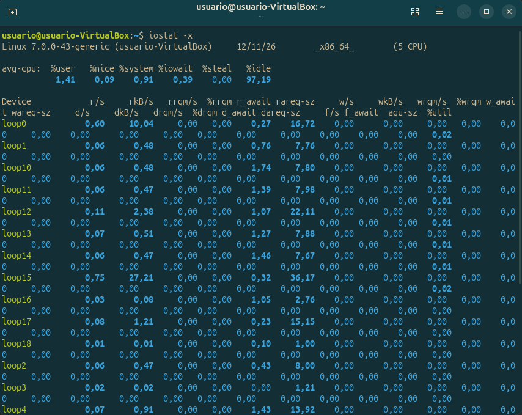 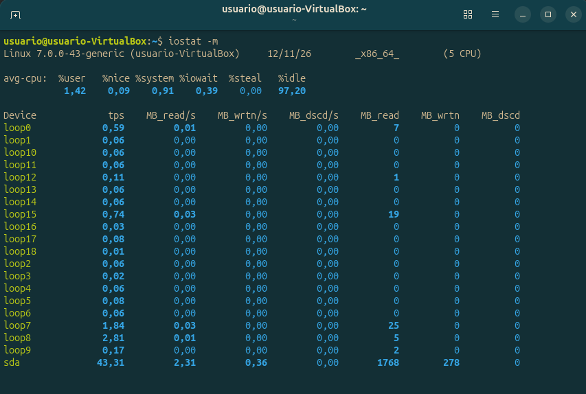  
   • Interpretación: En las métricas extendidas (-x), valores altos en %util (cercanos al 100%) o tiempos elevados en await indican saturación del disco. Sirve para diagnosticar si la lentitud de una base de datos o servidor web se debe a un cuello de botella en el almacenamiento.  

## 4. Tráfico de Red
## 4.1. tcpdump
   • Finalidad: Analizador de paquetes de red por línea de comandos (sniffer). Permite capturar y mostrar en tiempo real los paquetes que se transmiten o reciben a través de una interfaz de red.  
   • Instalación: Generalmente preinstalado; si no lo está:  
     sudo apt update && sudo apt install tcpdump -y  
   • Sintaxis y opciones:  
      sudo tcpdump [opciones] [expresión_filtro]  
        ◦ -i <interfaz>: Especifica la interfaz de red a escuchar (ej. eth0, ens33 o any para todas).  
        ◦ -n: Evita la resolución de nombres DNS y puertos, mostrando direcciones IP y números de puerto directamente (acelera la captura).  
   • Captura de pantalla:    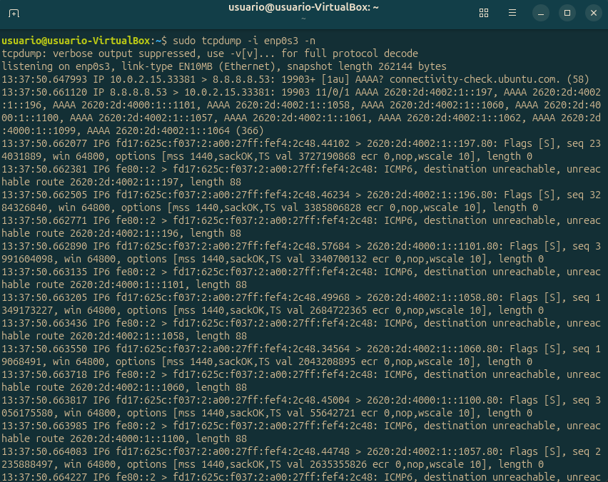 
   • Interpretación: Muestra la marca de tiempo, protocolo, IP/puerto de origen, IP/puerto de destino y flags TCP de cada paquete. Es imprescindible para depurar problemas de conectividad, comprobar si el tráfico llega al servidor o detectar tráfico malicioso.  
## 4.2. tcptrack
   • Finalidad: Monitoriza las conexiones TCP activas en una interfaz de red específica, mostrando su estado, direcciones de origen/destino y el ancho de banda que consume cada conexión en tiempo real.  
   • Instalación:  
      sudo apt update && sudo apt install tcptrack -y  
   • Sintaxis y opciones:  
      sudo tcptrack -i <interfaz> [opciones]  
        ◦ -i <interfaz>: Indica obligatoriamente la tarjeta de red a analizar (ej. sudo tcptrack -i enp0s3).  
        ◦ -r <segundos>: Establece el tiempo que una conexión cerrada permanece visible en pantalla antes de desaparecer.  
   • Captura de pantalla:    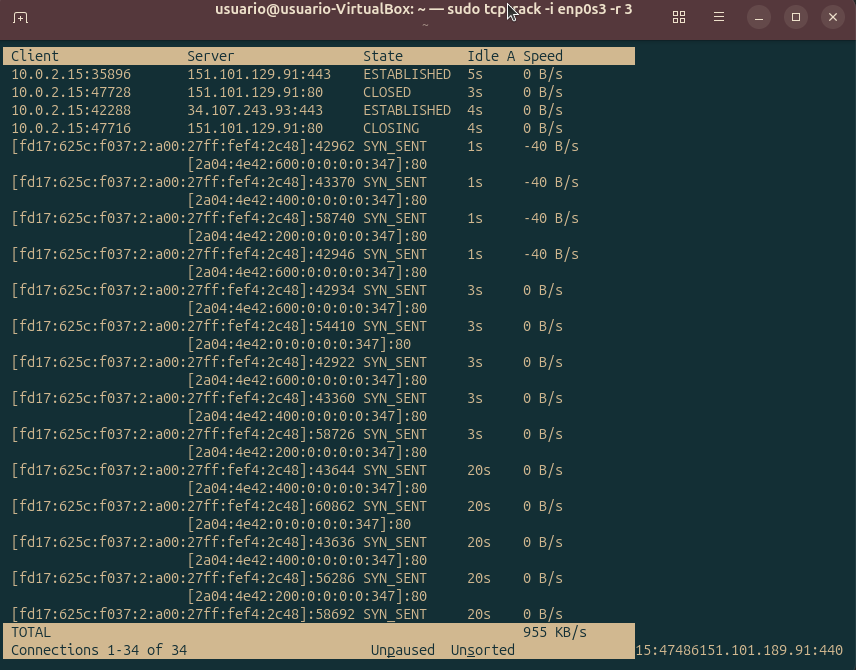   
   • Interpretación: Presenta una tabla ordenada por consumo de ancho de banda con el origen, destino, estado (ESTABLISHED, SYN_SENT, etc.) y velocidad de transferencia. Ayuda al administrador a identificar qué cliente o servicio externo está consumiendo todo el ancho de banda del servidor.  
## 4.3. iptraf (iptraf-ng)
   • Finalidad: Monitor de red interactivo basado en menús de consola (ncurses) que ofrece estadísticas detalladas sobre el tráfico IP, desglose por protocolos (TCP, UDP, ICMP), tamaño de paquetes y actividad por interfaz.  
   • Instalación:  
      sudo apt update && sudo apt install iptraf-ng -y  
   • Sintaxis y opciones:  
      sudo iptraf-ng [opciones]  
        ◦ -i <interfaz>: Inicia directamente el monitor de tráfico IP en la interfaz indicada saltándose el menú principal.  
        ◦ -s <interfaz>: Inicia el monitor de estadísticas por puertos TCP/UDP en dicha interfaz.  
   • Captura de pantalla:    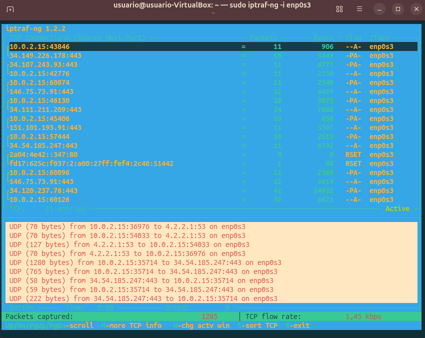 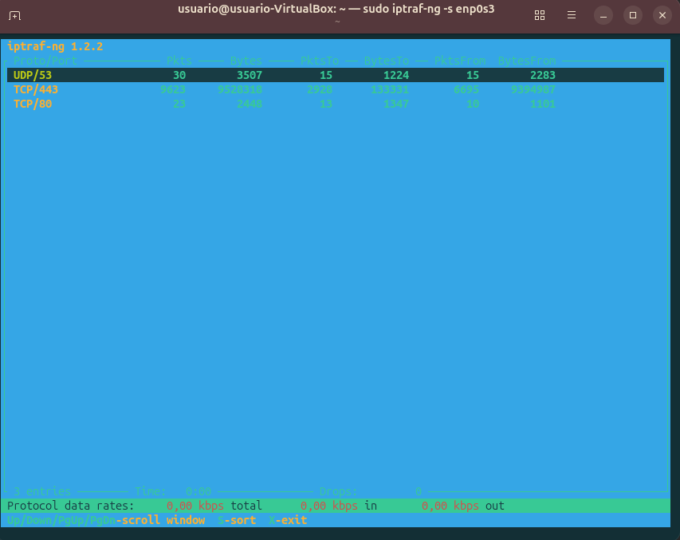  
   • Interpretación: Permite visualizar de forma estructurada qué puertos reciben más tráfico (por ejemplo, tráfico HTTP en el puerto 80 o SSH en el 22) y detectar picos anómalos de paquetes por segundo en la tarjeta de red.  
## 4.4. bmon
   • Finalidad: (Bandwidth Monitor) Herramienta de monitorización de ancho de banda y depuración de red que captura estadísticas de las interfaces y las representa mediante gráficos ASCII dinámicos en la terminal.  
   • Instalación:  
      sudo apt update && sudo apt install bmon -y  
   • Sintaxis y opciones:  
      bmon [opciones]  
        ◦ -p <interfaz>: Filtra y muestra únicamente la interfaz de red seleccionada (ej. bmon -p ens33).  
        ◦ -b: Muestra las tasas de transferencia en bits por segundo en lugar de bytes por segundo.  
   • Captura de pantalla:    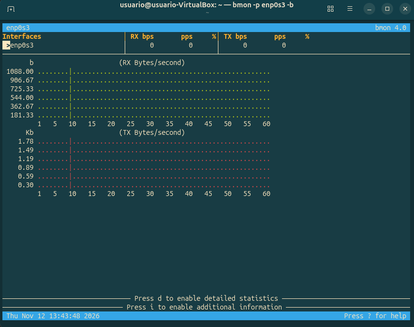  
   • Interpretación: Visualiza en tiempo real la tasa de recepción (RX) y transmisión (TX), paquetes por segundo y errores o descartes de paquetes (Errors/Dropped). Resulta muy útil para comprobar visualmente la estabilidad del enlace de red y detectar pérdidas de paquetes.  

## 5. Puertos y Conexiones
## 5.1. ss
   • Finalidad: (Socket Statistics) Herramienta moderna que sustituye al obsoleto netstat. Muestra información detallada sobre los sockets activos del sistema (conexiones TCP, UDP, UNIX y puertos en escucha).  
   • Instalación: Preinstalado por defecto en Ubuntu (paquete iproute2).  
   • Sintaxis y opciones:  
      ss [opciones]  
        ◦ -tuln: Muestra sockets TCP (-t) y UDP (-u) que están en estado de escucha (-l) mostrando puertos numéricos (-n) sin resolver nombres.  
        ◦ -p: Muestra el nombre y el PID del proceso propietario de cada socket (requiere sudo).  
   • Captura de pantalla:    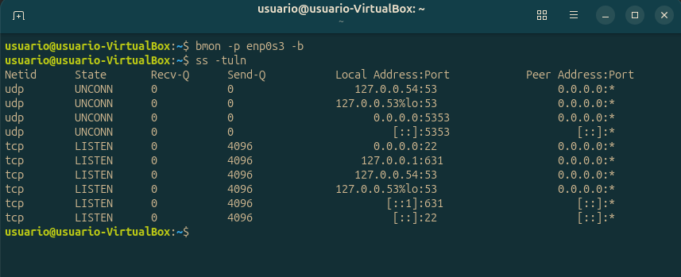 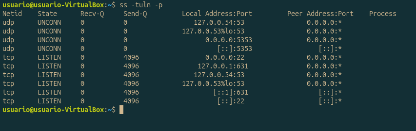  
   • Interpretación: Indica el protocolo (Netid), el estado (LISTEN, ESTAB), la dirección IP local y puerto (Local Address:Port) y el proceso asociado. Un administrador lo usa para verificar qué servicios están levantados localmente y en qué interfaces escuchan (ej. 0.0.0.0 vs 127.0.0.1).  
## 5.2. nmap
   • Finalidad: (Network Mapper) Herramienta de exploración de red y auditoría de seguridad. Permite descubrir equipos activos en una red, escanear puertos abiertos desde el exterior y detectar qué servicios y versiones se ejecutan detrás de ellos.  
   • Instalación:  
      sudo apt update && sudo apt install nmap -y  
   • Sintaxis y opciones:  
      nmap [opciones] <objetivo>  
        ◦ -sV: Sondea los puertos abiertos para determinar la información del servicio y su número de versión.  
        ◦ -p <puertos>: Escanea únicamente los puertos especificados (ej. nmap -p 22,80,443 192.168.1.10).  
   • Captura de pantalla:    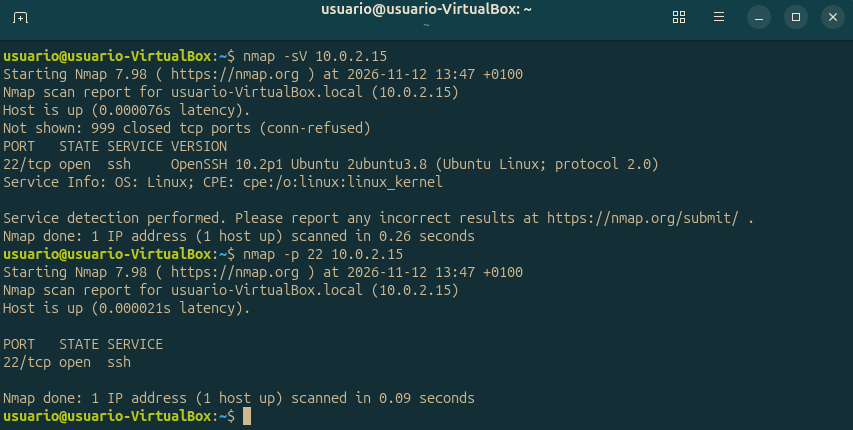  
   • Interpretación: Devuelve una tabla con el puerto, su estado (open, closed, filtered) y el servicio asociado. Es clave para comprobar la superficie de exposición de un servidor desde fuera y verificar que las reglas del cortafuegos (firewall) bloquean correctamente los puertos no deseados.  

## 6. Análisis de Resultados
### 1. ¿Cómo comprobarías la cantidad de memoria RAM disponible?
Utilizaría el comando free -h. En la salida obtenida, observaría la columna available dentro de la fila Mem, ya que este valor indica la memoria real disponible para ejecutar nuevas aplicaciones sin degradar el sistema, teniendo en cuenta tanto la memoria completamente libre (free) como la memoria caché que el kernel puede liberar de inmediato si hace falta.
### 2. ¿Qué diferencia existe entre df y du?
   • df (Disk Free): Analiza el sistema de archivos a nivel global (particiones o discos montados), informando sobre el espacio total, usado y disponible de toda la partición consultando los metadatos del sistema de archivos.  
    • du (Disk Usage): Calcula el espacio que ocupan archivos y directorios concretos recorriendo el árbol de carpetas y sumando el tamaño individual de cada elemento.  
### 3. ¿Qué diferencias existen entre ss y nmap?
   • ss: Es una herramienta de diagnóstico local que consulta directamente el kernel del propio sistema operativo para listar qué sockets, conexiones y puertos tiene abiertos la máquina en ese instante.  
   • nmap: Es un escáner de red activo (generalmente usado de forma remota o contra una IP) que envía paquetes de red hacia un objetivo para descubrir qué puertos responden desde el exterior y qué servicios están expuestos a través de la red y los firewalls.  
### 4. ¿Cómo comprobarías si un servidor tiene abierto el puerto 80?
   • Desde dentro del propio servidor (localmente): Ejecutaría sudo ss -tulpn | grep :80 para comprobar si algún proceso (como Apache o Nginx) está escuchando (LISTEN) en el puerto 80.  
   • Desde un equipo externo en la red (remotamente): Ejecutaría nmap -p 80 <IP_del_servidor> para verificar si el puerto responde como open y es accesible desde el exterior.  
### 5. ¿Qué herramienta utilizarías para detectar un posible cuello de botella en el disco?
Utilizaría iostat -x 2 (del paquete sysstat) o atop (con la vista de disco -d). Con iostat -x analizaría las columnas %util (si se acerca al 100%, el disco está saturado) y await (tiempo medio de espera de las peticiones I/O), lo que permite confirmar si el almacenamiento está frenando al resto del sistema.
### 6. ¿Por qué es importante monitorizar los recursos de un servidor?
La monitorización es esencial por cuatro motivos principales:    
    1. Prevención de caídas (Disponibilidad): Permite detectar saturaciones de disco, fugas de memoria o picos de CPU antes de que provoquen el colapso de los servicios.  
    2. Optimización y rendimiento: Ayuda a identificar cuellos de botella para ajustar configuraciones o ampliar hardware de forma justificada (capacity planning).  
    3. Seguridad: Facilita la detección temprana de comportamientos anómalos, como tráfico de red inusual, escaneos de puertos o procesos maliciosos ejecutándose en segundo plano.  
    4. Diagnóstico ágil: Proporciona datos objetivos que reducen drásticamente el tiempo de resolución cuando ocurre una incidencia en producción.  
